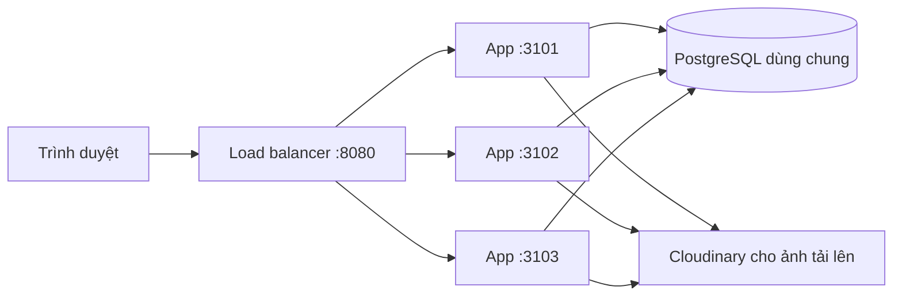

# Chạy nhiều instance cục bộ

Cụm local dùng cùng PostgreSQL như các instance Digi-Shop, không cần Redis hoặc Docker. Load balancer Node ở cổng 8080 phân phối HTTP và WebSocket tới ba app instance ở cổng 3101–3103.



| Nguồn trạng thái | Cách xử lý | Vì sao |
|---|---|---|
| Catalog, đơn hàng, giỏ hàng, phiên đăng nhập | PostgreSQL; JWT và refresh session dùng chung | Mọi instance đọc cùng dữ liệu nghiệp vụ và trạng thái phiên |
| Bộ đếm rate limit | Bảng PostgreSQL `rate_limit_buckets` khi chạy cụm | Request rải qua các instance vẫn dùng chung ngưỡng |
| Sự kiện đánh giá realtime | Ghi vào `review_events`; instance chỉ poll khi có WebSocket cục bộ | Người xem ở instance khác nhận cùng cập nhật mà không giữ kết nối DB luôn mở |
| Worker hết hạn thanh toán | Khoá `pg_try_advisory_xact_lock` trong transaction | Chỉ một instance chạy lượt xử lý tại một thời điểm; khoá tự nhả khi transaction kết thúc |
| Ảnh admin tải lên | Cloudinary khi được cấu hình; mặc định local | Ảnh tải lên không phụ thuộc ổ đĩa container; ảnh mẫu vẫn nằm trong `data/product-images/` |
| Kết nối WebSocket của khách | Giữ tại instance nhận kết nối; load balancer proxy `Upgrade` | Bản tin từ PostgreSQL được phát tới các room cục bộ phù hợp |

## Chuẩn bị

1. Khởi động PostgreSQL local và đảm bảo database `digishop` đã migrate, seed.
2. Trong `.env`, thêm `http://localhost:8080` vào danh sách `APP_ORIGIN` để origin kiểm tra WebSocket chấp nhận địa chỉ của cụm. Không cần sửa `.env` của ứng dụng một instance.
3. Cụm tự đặt `INSTANCE_ID=local-1..3`, `RATE_LIMIT_STORE=database`, `REVIEW_EVENTS_MODE=database` và `TRUST_PROXY=1` cho các app con. Cùng `DATABASE_URL` được kế thừa từ môi trường của ứng dụng.

## Chạy và chứng minh

Từ terminal PowerShell tại thư mục dự án:

```powershell
npm run cluster
```

Lệnh chạy ba app ở cổng 3101–3103 và load balancer ở cổng 8080. Mở `http://localhost:8080`. Nhấn Ctrl+C trong terminal để tắt cụm.

Smoke đợi tối đa 10 giây để cả ba app khỏe trước khi gửi 30 yêu cầu.

Trong terminal khác:

```powershell
npm run cluster:smoke
```

Smoke gọi `/healthz` 30 lần qua một URL `http://localhost:8080` và in số lượt theo `X-Instance`. Cần thấy `local-1`, `local-2` và `local-3`.

Các kiểm tra thủ công:

1. Mở cùng một Product ở hai tab qua cổng 8080. Kiểm tra `X-Instance` khác nhau, rồi tạo hoặc sửa Product review ở tab thứ nhất; tab thứ hai nhận Live review update trong tối đa 3 giây.
2. Gửi đăng nhập sai liên tục. Rate limit phải chặn đúng ngưỡng dù các request lần lượt đi qua nhiều instance.
3. Tạo một Payment attempt sandbox rồi để hết hạn; log worker cho biết instance nào xử lý. Hai instance không được trả tồn kho hoặc Voucher quantity hai lần.
4. Dừng app `local-2` bằng đúng PID mà `npm run cluster` đã in:

   ```powershell
   $instancePid = Read-Host "Nhập PID của app local-2 trong terminal cụm"
   Stop-Process -Id ([int]$instancePid)
   ```

   Trong tối đa 5 giây load balancer loại instance đó; trang vẫn hoạt động qua hai instance còn lại. Kết thúc bằng Ctrl+C ở terminal chạy `npm run cluster`.

### Ảnh chụp minh chứng

- **`cluster:smoke` đủ ba instance:** dán ảnh chụp kết quả tại đây.
- **WebSocket chéo instance:** dán ảnh hai tab với `X-Instance` khác nhau và Live review update tại đây.
- **Failover:** dán ảnh trang vẫn hoạt động sau khi dừng app ở cổng 3102 tại đây.

## Trên Render (một instance)

Bản deploy trên Render dùng gói miễn phí nên chỉ có **một instance** (`RATE_LIMIT_STORE=memory`, `REVIEW_EVENTS_MODE=direct`; xem [deploy.md](deploy.md)). Khả năng nhiều instance được chứng minh bằng cụm ba tiến trình ở phần trên: `/healthz` và `X-Instance` luân phiên, đánh giá realtime chéo instance, giới hạn đăng nhập dùng chung qua database, worker thanh toán chạy một nơi nhờ advisory lock, ảnh tải lên ở Cloudinary.

Trên Render, mở `https://<tên-dịch-vụ>.onrender.com/healthz` để thấy `X-Instance` của dịch vụ, và ghi rõ trong `Readme.txt` và video rằng bằng chứng scaling nằm ở cụm local. Muốn chạy nhiều instance trên một dịch vụ, cần gói Render trả phí cho phép scale ngang, rồi đặt `RATE_LIMIT_STORE=database` và `REVIEW_EVENTS_MODE=database`.

Nếu một nền tảng khác cho phép nhiều instance, `npm run cloud:smoke -- https://<url> 30` gửi 30 request `/healthz` song song và gom theo `X-Instance`.

### Ảnh chụp minh chứng trên Render

- **`/healthz`:** dán ảnh phản hồi từ địa chỉ công khai tại đây.
- **Ghi chú trong Readme.txt:** nhắc rằng cụm ba instance chạy trên máy và ảnh minh chứng ở mục trước.
